

 

<table width="560" data-align="center" data-border="1" data-bordercolor="005544">
<colgroup>
<col style="width: 100%" />
</colgroup>
<tbody>
<tr>
<td style="text-align: center;" width="560" data-bgcolor="#005544"><table width="540" data-align="center" data-bgcolor="#005544" data-border="0">
<colgroup>
<col style="width: 33%" />
<col style="width: 33%" />
<col style="width: 33%" />
</colgroup>
<tbody>
<tr>
<td style="text-align: left;" width="220" data-bgcolor="005544" data-valign="top"></td>
<td style="text-align: center;" width="100" data-bgcolor="005544"> 
</td>
<td style="text-align: right;" width="220" data-bgcolor="005544"></td>
</tr>
</tbody>
</table></td>
</tr>
</tbody>
</table>

\

**WELCOME**\

 WHEREVER YOU ARE IN THE WORLD, IF YOU ARE INTENT ON PLANNING AND BUILDING A THRIVING NEIGHBORHOOD, 

THIS WEBSITE IS FOR YOU.

<table data-align="center" width="560" data-border="1" data-bgcolor="ffffdd">
<tbody>
<tr>
<td width="120" data-valign="top"><a href="javascript:void(0)" onmouseover="javascript:togglePic(&#39;fresno&#39;); " onmouseout="javascript:togglePic(&#39;fresno&#39;);">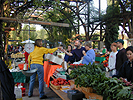</a></td>
<td width="120" data-valign="top"><a href="javascript:void(0)" onmouseover="javascript:togglePic(&#39;travis&#39;); " onmouseout="javascript:togglePic(&#39;travis&#39;);">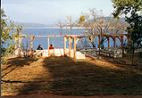</a></td>
<td width="120" data-valign="top"><a href="javascript:void(0)" onmouseover="javascript:togglePic(&#39;mexicali&#39;); " onmouseout="javascript:togglePic(&#39;mexicali&#39;);">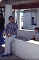</a></td>
<td width="120" data-valign="top"><a href="javascript:void(0)" onmouseover="javascript:togglePic(&#39;eishin&#39;); " onmouseout="javascript:togglePic(&#39;eishin&#39;);">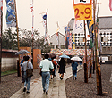</a></td>
</tr>
<tr>
<td colspan="4" data-border="0"> Depicted here are some places we have built. Mouseover to enlarge.</td>
</tr>
</tbody>
</table>

<table data-align="center" width="560" data-border="1" data-bgcolor="ffffdd">
<colgroup>
<col style="width: 25%" />
<col style="width: 25%" />
<col style="width: 25%" />
<col style="width: 25%" />
</colgroup>
<tbody>
<tr>
<td colspan="4" style="text-align: center; padding: 10px;">  Building Beauty: Creating Living Wholeness in the Built World, a post graduate program that continues the legacy of Christopher Alexander 
<a href="http://www.buildingbeauty.org" style="color: red; font-weight: bold;" target="blank"><em>www.buildingbeauty.org</em></a> 
Write to <a href="mailto:hello@buildingbeauty.org">hello@buildingbeauty.org</a> to explore how you can be a part of it.</td>
</tr>
</tbody>
</table>

<table width="560" data-align="center" data-border="1" data-cellpadding="8" data-bgcolor="ffffdd">
<colgroup>
<col style="width: 100%" />
</colgroup>
<tbody>
<tr>
<td width="80%" data-valign="top">

If you are one of <strong>a group of friends</strong> who are talking about building a new place to live a better life, this website can show you ways of working that are inspiring and related to the things which matter in your lives. The ACTION &amp; PRACTICE pages will guide you.

If you are a <strong>developer</strong> or <strong>landowner</strong>, this website can show you ways of working that are more capable of creating healthy, hospitable and beautiful places for people to live, than present forms of practice typically allow. It does not cost more. See the DEVELOPER'S PAGE.

If your <strong>family</strong> or <strong>business</strong> is helping to rebuild an old neighborhood, or moving to a new one, this website will give you tools and a voice which will be heard, so you can genuinely influence what happens.

If you are a <strong>community organizer</strong>, or a <strong>leader</strong> in a local community, this website will give you tools to be sure that residents and local businesses can play an effective and practical part in decision making, which will be heard.

If you are a <strong>mayor</strong>, <strong>city manager</strong>, <strong>local official</strong> or <strong>city planner</strong> who wants to help create a vibrant addition to your town or city, the ACTION &amp; PRACTICE pages will show you how to support and become involved in such a process so it can be effective.

If you are a <strong>builder</strong> or a <strong>craftsperson</strong>, this site will show you a way of offering your services that allows the making of beauty in buildings to be a fundamental part of your contribution -- more so than is typically allowed in the present commercial context.

If you are an <strong>architect</strong> or <strong>engineer</strong>, this site will show you how working with a community, when done well, is likely to create a neighborhood with real beauty and spirit.

If you are a <strong>teacher</strong> or a <strong>student</strong> or an <strong>academic</strong> you will find material throughout this website that naturally forms a basis for class instruction, research, and student projects. To consider teaching the use of generative codes, visit the THEORY &amp; EXAMPLES section. The archive page provides academic papers, history and background of how generative codes were developed.
</td>
</tr>
</tbody>
</table>

|  |  |  |
|----|----|----|
| <a href="javascript:void(0)" onmouseover="javascript:togglePic(&#39;backterrace&#39;); " onmouseout="javascript:togglePic(&#39;backterrace&#39;);">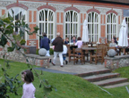</a> | <a href="javascript:void(0)" onmouseover="javascript:togglePic(&#39;agate&#39;); " onmouseout="javascript:togglePic(&#39;agate&#39;);">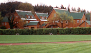</a> |  |

<table width="560" data-align="center" data-border="1" data-bgcolor="ffffdd" data-cellpadding="8">
<colgroup>
<col style="width: 33%" />
<col style="width: 33%" />
<col style="width: 33%" />
</colgroup>
<tbody>
<tr>
<td colspan="3"><strong>Our goal is to help everyone make our neighborhoods places of belonging, places of health and well-being, and places where people will want to live and work. This has become possible through the use of Generative Codes, Christopher Alexander's latest work in the effort to make possible conception and construction of living, beautiful communities that have real guts -- not the sugary sweetness of pseudo-traditional architecture.</strong> 

The tools offered are intended for the use of ordinary people, families, communities, developers, planners, architects, designers and builders; public officials, local representatives, and neighbors; business owners and people who have commercial interests. The processes here are expressed in the belief that the common-sense, plain truth about laying out a neighborhood, or repairing one, is equally valid for all comers, amateurs and professionals. They help people build or rebuild neighborhoods in ways that contribute something to their lives. Many of the tools have their origin in 30 years of work published in Alexander's <a href="../ht-0/natureoforder.htm"><em>The Nature of Order</em></a>. 

</td>
</tr>
</tbody>
</table>

|  |  |  |  |
|----|----|----|---:|
|  | <a href="javascript:void(0)" onmouseover="javascript:togglePic(&#39;heisey&#39;); " onmouseout="javascript:togglePic(&#39;heisey&#39;);">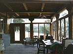</a> | <a href="javascript:void(0)" onmouseover="javascript:togglePic(&#39;couple&#39;); " onmouseout="javascript:togglePic(&#39;couple&#39;);">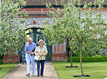</a> |  |

<table data-align="center" width="560" data-border="1" data-bgcolor="ffffdd" data-cellpadding="8">
<colgroup>
<col style="width: 33%" />
<col style="width: 33%" />
<col style="width: 33%" />
</colgroup>
<tbody>
<tr>
<td colspan="3">

<strong>In our view, almost any part of the environment may be viewed as a neighborhood.</strong> A neighborhood can be very small (less than an acre), or quite large (hundreds of acres). It can be a hospital, a business, a group of workshops, a place where people live and work. A neighborhood is any group of people and their activities, animals, buildings, plants, and public space. Neighborhoods of different sizes are usually nested inside one another.

<strong>In this spirit, piece by piece, we of our generation, and the next generations, may be able to rebuild the world.</strong></td>
</tr>
</tbody>
</table>

<table data-align="center" width="560" data-border="1" data-bgcolor="ffffdd">
<tbody>
<tr>
<td width="120" data-valign="top"></td>
<td colspan="3" style="text-align: center;" width="560" data-valign="top"><a href="javascript:void(0)" onmouseover="javascript:togglePic(&#39;party&#39;); " onmouseout="javascript:togglePic(&#39;party&#39;);">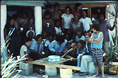</a></td>
<td width="120" data-valign="top"><a href="javascript:void(0)" onmouseover="javascript:togglePic(&#39;layout&#39;); " onmouseout="javascript:togglePic(&#39;layout&#39;);">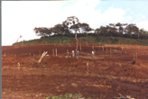</a></td>
</tr>
</tbody>
</table>

<table data-align="center" width="560" data-bgcolor="ffffdd">
<colgroup>
<col style="width: 33%" />
<col style="width: 33%" />
<col style="width: 33%" />
</colgroup>
<tbody>
<tr>
<td colspan="3" style="text-align: center;"><em>This website is written by Chris Alexander, Maggie Moore Alexander, Randy Schmidt, Nick Littlestone, 
with Bev Behrman and Howard Davis.</em></td>
</tr>
</tbody>
</table>

<table width="560" data-align="center" data-border="1" data-bgcolor="ffffdd">
<tbody>
<tr>
<td colspan="2" style="text-align: center;">CENTER FOR ENVIRONMENTAL STRUCTURE established 1967</td>
</tr>
</tbody>
</table>

|                                                                  |
|:----------------------------------------------------------------:|
| 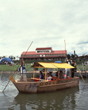 |

<table width="560" data-align="center" data-border="1" data-cellpadding="8" data-bgcolor="ffffdd">
<colgroup>
<col style="width: 100%" />
</colgroup>
<tbody>
<tr>
<td style="text-align: left;" data-bgcolor="ffffdd">
There is a great deal of material posted on this website, especially under the headings of ACTION &amp; PRACTICE and THEORY &amp; EXAMPLES -- more than one would expect to find on a typical website. We are using this medium so that we can make these generative codes and building practices available to a world-wide audience quickly, and at as low a cost as possible. Our efforts to write and organize the material for easy use continue. 
 
 If you would like information, please <strong><a href="contact.htm">CONTACT</a></strong> us 
If you would like help, please check our 
<strong><a href="services.htm">SERVICES</a></strong>
. 
If you represent a <strong>community organization</strong> or a <strong>professional developer</strong>, and would like to consider applying the methods described on this website, to one of your projects, 
please  <strong><a href="mailto:interestedlist@livingneighborhoods.org">E-MAIL US</a></strong> , and tell us what kind of help you might need. 
</td>
</tr>
</tbody>
</table>

<table data-align="center" width="560" data-border="1" data-bgcolor="ffffdd">
<tbody>
<tr>
<td width="120" data-valign="top"><a href="javascript:void(0)" onmouseover="javascript:togglePic(&#39;medlock&#39;); " onmouseout="javascript:togglePic(&#39;medlock&#39;);">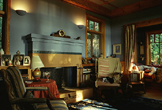</a></td>
<td colspan="3" style="text-align: center;" width="560" data-valign="top"><a href="javascript:void(0)" onmouseover="javascript:togglePic(&#39;upham&#39;); " onmouseout="javascript:togglePic(&#39;upham&#39;);">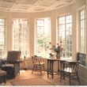</a></td>
<td width="120" data-valign="top"><a href="javascript:void(0)" onmouseover="javascript:togglePic(&#39;medlockblue&#39;); " onmouseout="javascript:togglePic(&#39;medlockblue&#39;);">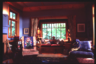</a></td>
</tr>
</tbody>
</table>

\

© 2006 CES

Terms of Use & Copyright Notice \

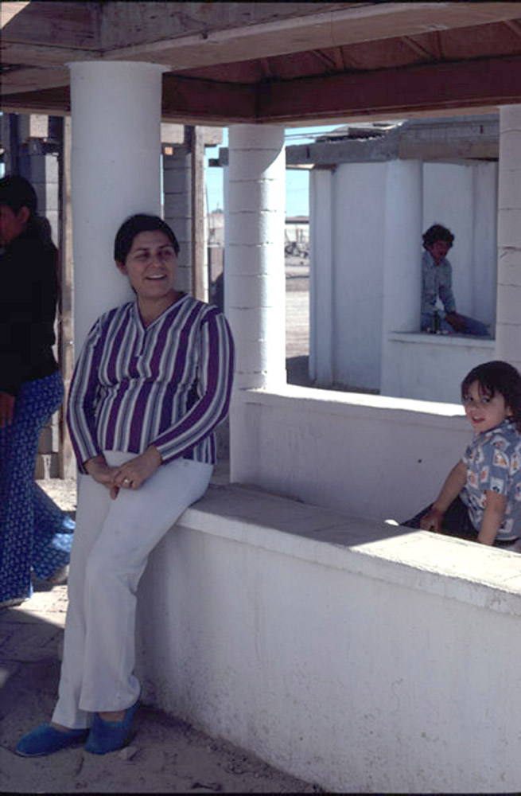

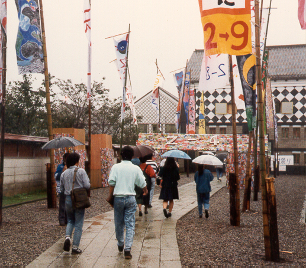

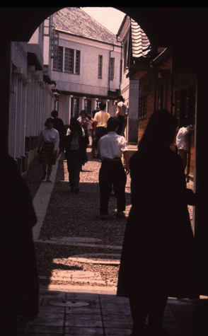

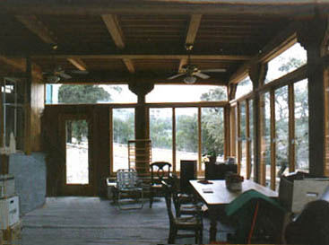

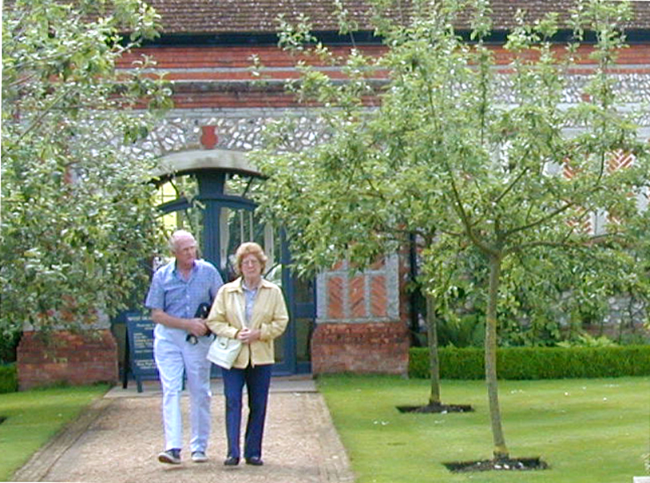

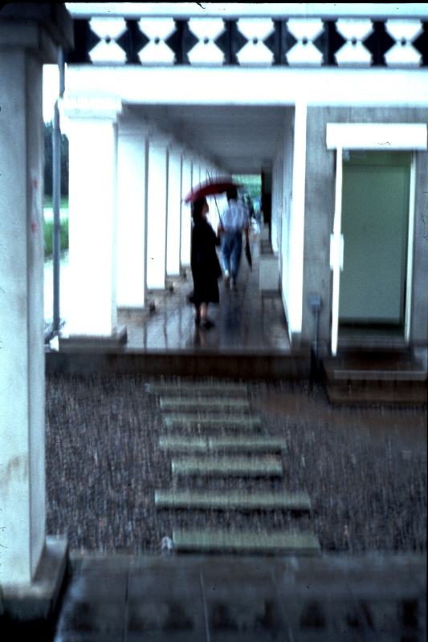

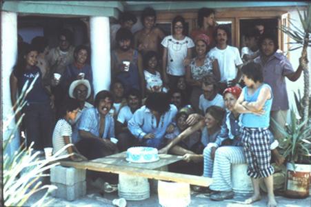

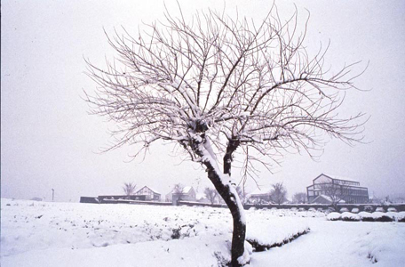

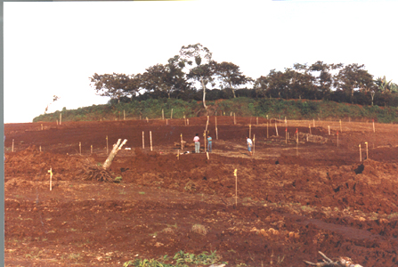

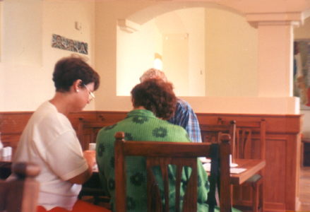

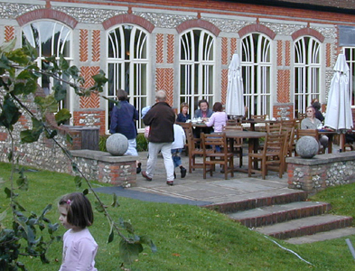

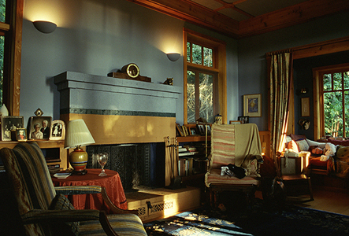

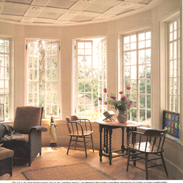

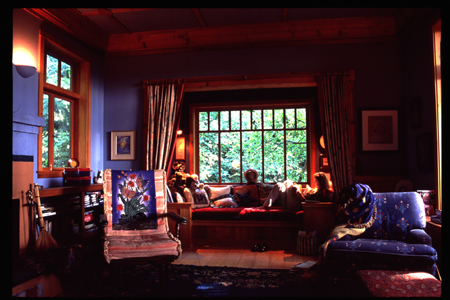

