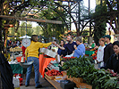
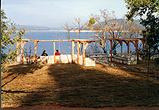
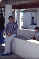
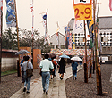
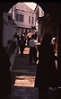
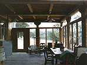
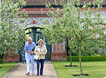

# Living Neighbourhoods

## Welcome

> Wherever you are in the world, if you are intent on planning and building a thriving neighbourhood, this website is for you.

| | | | |
|---|---|---|---|
|  |  |  |  |

These are some of the places we have built.

If you are one of **a group of friends** talking about building a new place to live a better life, this website can show you ways of working that are inspiring and connected to the things that matter in your lives. The [Action & Practice](actions) pages will guide you.

If you are a **developer or landowner**, this website offers ways of creating healthy, hospitable, and beautiful places for people to live—ways more capable than present forms of practice typically allow.

If your **family, business, or community** is rebuilding an old neighbourhood or moving to a new one, this website offers tools and a voice with which to influence what happens.

If you are a **mayor, city manager, public official, city planner, or community organiser**, the practical material shows how residents and local businesses can play an effective part in decision-making.

If you are a **builder or craftsperson**, this site presents a way of working in which making beauty is a fundamental part of your contribution.

If you are an **architect or engineer**, it shows how working well with a community can create a neighbourhood with real beauty and spirit.

If you are a **teacher, student, or academic**, you will find material for instruction, research, and projects throughout the site. Begin with [Theory & Examples](theory) and the [Archive](archive).

## Our goal

**Our goal is to help everyone make our neighbourhoods places of belonging, health, and well-being—places where people will want to live and work.**

This becomes possible through the use of **Generative Codes**: Christopher Alexander's work toward the conception and construction of living, beautiful communities with real substance.

The tools are intended for ordinary people, families, communities, developers, planners, architects, designers, builders, public officials, local representatives, neighbours, and business owners. They begin from the belief that the plain truth about laying out or repairing a neighbourhood is equally valid for amateurs and professionals.

Many of these tools have their origin in thirty years of work published in Alexander's [*The Nature of Order*](ht-0/natureoforder).

| | | | |
|---|---|---|---|
|  |  |  |  |

## What is a neighbourhood?

Almost any part of the environment may be viewed as a neighbourhood. It can be very small—less than an acre—or quite large, extending over hundreds of acres. It can be a hospital, a business, a group of workshops, or a place where people live and work.

A neighbourhood is any group of people and their activities, animals, buildings, plants, and public space. Neighbourhoods of different sizes are usually nested inside one another.

> In this spirit, piece by piece, we of our generation and the next generations may be able to rebuild the world.

## Explore the site

- [Action & Practice](actions) — practical methods for diagnosis, vision, generative codes, building, and repair.
- [Theory & Examples](theory) — the ideas and built work behind the methods.
- [Archive](archive) — papers, history, phases, and supporting material.
- [Contact](ht-0/contact) and [Services](ht-0/services).

This website was written by Chris Alexander, Maggie Moore Alexander, Randy Schmidt, and Nick Littlestone, with Bev Behrman and Howard Davis, for the **Center for Environmental Structure**, established in 1967.

[About this edition](about)
