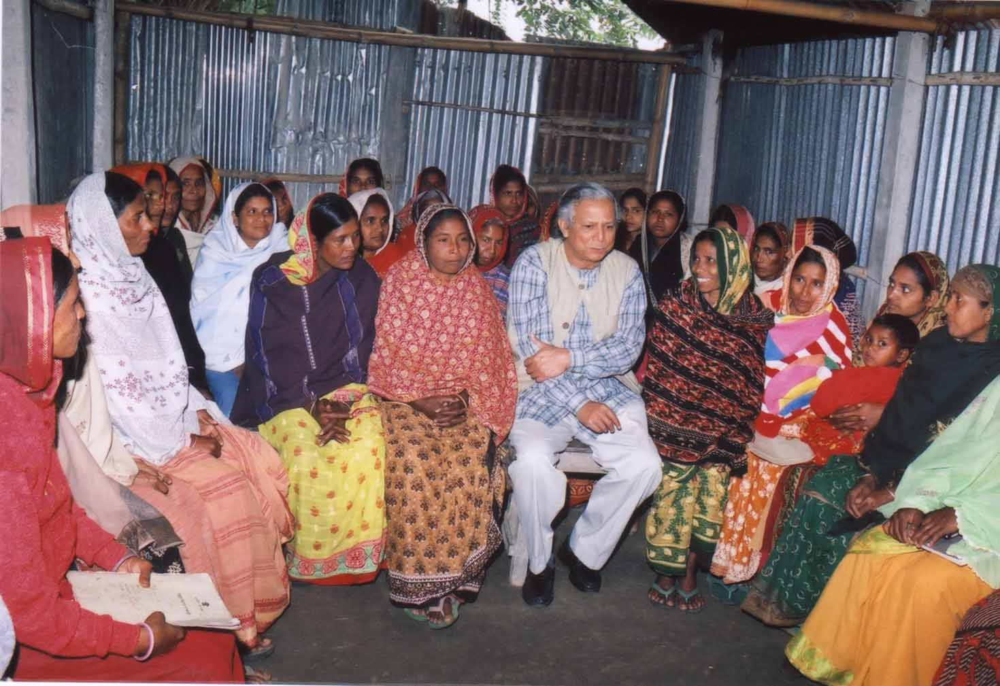

 

<table data-align="center" width="560">
<colgroup>
<col style="width: 33%" />
<col style="width: 33%" />
<col style="width: 33%" />
</colgroup>
<tbody>
<tr>
<td colspan="3" style="text-align: center;"> 
</td>
</tr>
<tr>
<td style="text-align: center;" data-bgcolor="red"><em><strong>Section Four</strong></em></td>
<td style="text-align: center;"></td>
<td style="text-align: center;"></td>
</tr>
</tbody>
</table>

<table width="560" data-border="3" data-align="center">
<tbody>
<tr>
<td colspan="2" style="text-align: center;" width="560" data-bgcolor="white">FOURTH PHASE OF UNFOLDING</td>
</tr>
</tbody>
</table>

|  |  |
|----|:--:|
|   | INDIVIDUAL UNFOLDINGS |

<table data-align="center" width="560" data-border="3" data-rules="cols" data-background="../actions/pics/people/yag-meeting3.jpg">
<colgroup>
<col style="width: 50%" />
<col style="width: 50%" />
</colgroup>
<tbody>
<tr>
<td style="text-align: center;" width="230" data-valign="top"><table width="230">
<colgroup>
<col style="width: 100%" />
</colgroup>
<tbody>
<tr>
<td width="230" data-valign="top">Section 4 
Modifying Your Code 
 
 
 
<strong>Modify the code to fit 
your local culture, your needs and your 
project</strong></td>
</tr>
</tbody>
</table></td>
<td data-valign="top"><table>
<colgroup>
<col style="width: 50%" />
<col style="width: 50%" />
</colgroup>
<tbody>
<tr>
<td style="text-align: right;" width="35" data-valign="top">4.1  
</td>
<td width="295" data-valign="top"><a href="../actions/genetics.htm" class="type2">INTRODUCTION: GENETICS</a>  
The code for your project, starts with generic code already present on this website, and then gets modified by you. 
</td>
</tr>
<tr>
<td style="text-align: right;" width="35" data-valign="top">4.2  
</td>
<td width="325" data-valign="top"><a href="../actions/baselinecode.htm" class="type2">OUR BASELINE CODE</a>  
The code for your project, starts with generic code already present on this website, and then gets modified by you. 
</td>
</tr>
<tr>
<td style="text-align: right;" width="35" data-valign="top">4.3  
</td>
<td width="325" data-valign="top"><a href="../actions/culture.htm" class="type2">LOCAL CULTURE</a> 
Respect your local culture, and decipher that local and cultural particulars: then graft this local culture into the generic baseline code. 
</td>
</tr>
<tr>
<td style="text-align: right;" width="35" data-valign="top">4.4  
</td>
<td width="325" data-valign="top"><a href="../actions/entities.htm" class="type2">NEW ENTITIES</a> 
Describe, in words, the entities which must be created to create the new culture that is in process of arising in your neighborhood. 
</td>
</tr>
<tr>
<td style="text-align: right;" width="35" data-valign="top">4.5  
</td>
<td width="325" data-valign="top">INSERTING AND AMALGAMATING CODE 
Marrying your special code with our baseline code, to make a functional and workable code to generate your own particular neighborhood. 
</td>
</tr>
</tbody>
</table></td>
</tr>
</tbody>
</table>

This phase has five steps to help you, your friends, and partners get your local culture and special ideas into the neighborhood

*A meeting of a local community whose members are in the process of modifying a generative code. A group of Bangladeshi villagers meeting with Muhammad Yunus during the work of clarifying the operation of the local village-owned bank. Yunus is an inspiration to us!* \

© 2006 CES

Terms of Use & Copyright Notice 
